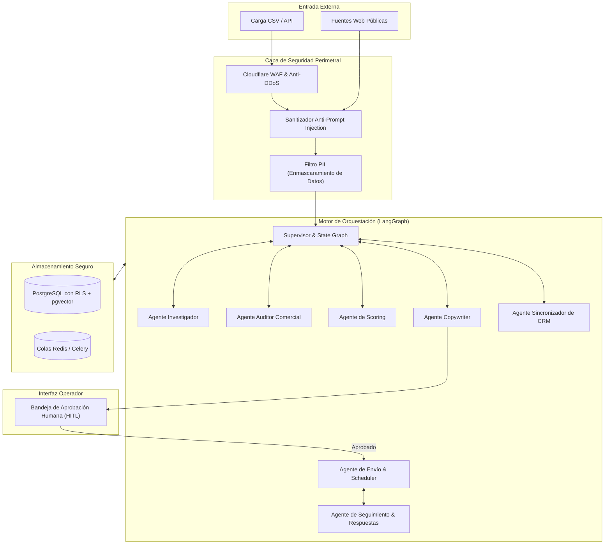

# Especificación de Diseño: Departamento de Ingresos Digital Multi-Agente (RevOps AI)

**Fecha:** 2026-10-27  
**Estado:** Aprobado / En especificación  
**Autor:** Antigravity & Equipo de Ingeniería  

---

## 1. Visión General del Producto

El **Departamento de Ingresos Digital Multi-Agente** es un sistema modular de Revenue Operations (RevOps) diseñado para automatizar y optimizar la prospección, investigación, cualificación, diagnóstico comercial, redacción personalizada y sincronización en CRM para clientes B2B y servicios profesionales de alto valor (iniciando con clínicas de salud privada).

El sistema está diseñado bajo una arquitectura desacoplada donde el **70% del motor es agnóstico y reutilizable**, mientras que el **30% restante corresponde a configuraciones específicas de sector (YAML/JSON)**, permitiendo replicar el modelo en múltiples industrias sin modificar el código fuente.

---

## 2. Requisitos y Objetivos de Diseño

### 2.1 Requisitos Funcionales
1. **Ingesta Controlada & Búsqueda:** Carga de prospectos vía CSV/API y capacidad futura de descubrimiento mediante scraping web.
2. **Investigación Enriquecida:** Extracción automática de información corporativa (sitio web, perfiles, presencia digital, tiempos de respuesta, reseñas).
3. **Microdiagnóstico Comercial:** Auditoría no invasiva de debilidades comerciales y operativas (e.g., falta de agendamiento online, tiempos de respuesta deficientes). Queda estrictamente prohibido emitir diagnósticos médicos o clínicos.
4. **Lead Scoring Determinístico y Semántico:** Puntuación de 1 a 100 basada en criterios de ajuste con el Perfil de Cliente Ideal (ICP).
5. **Generación Hiper-Personalizada:** Redacción de mensajes de contacto basados exclusivamente en la evidencia recopilada.
6. **Bandeja de Aprobación Humana (Human-in-the-Loop):** Punto de control obligatorio donde un operador aprueba, ajusta o rechaza los mensajes antes de su salida.
7. **Gestión de Respuestas y Seguimiento:** Detección de intenciones (interés, solicitud de aplazamiento, rechazo/baja) con programación automática de reintentos y actualización de listas negras.
8. **Sincronización Bidireccional con CRM:** Actualización de estados, notas y tareas en HubSpot/Salesforce/Pipedrive o almacenamiento local equivalente.

### 2.2 Requisitos de Seguridad y Cumplimiento (Zero-Trust)
1. **Defensa contra Inyecciones (Prompt & SQL):** 
   - Arquitectura Dual-LLM: Todo contenido no estructurado proveniente de internet es procesado primero por un modelo sanitizador sin estado.
   - Prohibición de SQL dinámico; uso estricto de ORM tipado con parámetros (SQLAlchemy / Prisma).
2. **Aislamiento Multi-Tenant (Cero Goteras / Filtraciones):**
   - Base de datos relacional PostgreSQL con políticas de **Row-Level Security (RLS)** obligatorias a nivel de base de datos.
   - Cifrado en reposo (AES-256) y en tránsito (TLS 1.3).
3. **Protección de Datos Sensibles (PII):**
   - Interceptor de sanitización (Microsoft Presidio) para enmascarar automáticamente nombres de pacientes, números de historia clínica, tarjetas de crédito o datos identificativos antes de consultar APIs externas de LLM.
4. **Blindaje Legal y Anti-Spam:**
   - Procesamiento instantáneo de solicitudes de baja (`opt-out`) y lista negra global inmutable.
   - Control de límites de envío (*rate-limiting*) y rotación de canales para proteger la reputación de dominios y números telefónicos.

---

## 3. Arquitectura del Sistema



---

## 4. Máquina de Estados del Prospecto (Lifecycle)

Cada prospecto se rige por una máquina de estados estricta y trazable:

1. `INGESTED`: Datos iniciales validados y almacenados.
2. `RESEARCHING`: Agente Investigador recopila evidencia de fuentes externas autorizadas.
3. `AUDITING`: Agente Auditor identifica oportunidades comerciales/operativas de mejora.
4. `SCORING`: Agente de Scoring calcula idoneidad.
   - Si score < umbral: transiciona a `DISCARDED`.
   - Si score >= umbral: transiciona a `QUALIFIED`.
5. `DRAFTING`: Agente Copywriter genera la propuesta de contacto.
6. `PENDING_HUMAN_APPROVAL`: El borrador queda en el panel de control esperando validación humana.
   - Si el operador rechaza: `ARCHIVED` o `REVISION_REQUESTED`.
   - Si el operador aprueba: `APPROVED_FOR_SEND`.
7. `SENT`: Mensaje despachado respetando horario hábil comercial y límites diarios.
8. `WAITING_REPLY`: En espera de interacción o programado para seguimiento automático.
9. `CONVERTED`: El prospecto agenda una llamada o muestra interés comercial.
10. `OPT_OUT`: El prospecto solicita no ser contactado; bloqueado permanentemente en todas las instancias.

---

## 5. Diseño Modular (El 70% Reutilizable vs. 30% Dominio)

### 5.1 Capa de Configuración Declarativa
La adaptación a nuevas verticales de negocio se realiza exclusivamente mediante archivos YAML de configuración por cliente o sector:

```yaml
# config/sectors/clinicas.yaml
sector_id: "clinicas_salud_v1"
compliance:
  strictly_forbidden_topics:
    - "diagnosticos_medicos_especificos"
    - "promesas_de_curacion"
    - "referencias_a_patologias_de_pacientes"
  required_disclaimer: "Esta es una comunicación comercial de optimización operativa para la administración de la clínica."

research:
  primary_sources: ["google_maps", "website_home", "doctoralia_profile"]
  signals_to_detect:
    - signal: "has_online_booking"
      type: "boolean"
    - signal: "whatsapp_widget_present"
      type: "boolean"
    - signal: "google_rating_avg"
      type: "float"

scoring:
  weights:
    digital_gap: 0.5
    market_reputation: 0.3
    estimated_size: 0.2
  min_qualification_score: 65

copywriting:
  tone: "consultivo_ejecutivo"
  value_proposition: "Aumentar la conversión de presupuestos no aceptados mediante automatización y seguimiento omnicanal."
```

---

## 6. Stack Tecnológico & Coste Operativo

| Componente | Tecnología Seleccionada | Justificación | Coste en Desarrollo |
| :--- | :--- | :--- | :--- |
| **Lenguaje** | Python 3.11+ | Ecosistema de referencia para IA y procesamiento asíncrono. | \$0 |
| **Framework API** | FastAPI | Alto rendimiento, tipado estricto con Pydantic y documentación OpenAPI. | \$0 |
| **Orquestación de Agentes** | LangGraph | Soporte nativo para grafos con estado, persistencia y Human-in-the-Loop. | \$0 |
| **Base de Datos & Auth** | PostgreSQL (Supabase) | Row-Level Security (RLS) nativo, cifrado AES-256 y API REST/GraphQL. | \$0 (Free Tier) |
| **Colas de Tareas** | Redis / Celery | Procesamiento asíncrono y desacoplado de agentes. | \$0 (Local/Free) |
| **Seguridad Perimetral** | Cloudflare | WAF, protección anti-DDoS y mitigación de bots. | \$0 (Free Tier) |
| **Modelos de IA** | Gemini 2.5 Flash / Claude 3.5 Haiku | Coste marginal, alta velocidad y capacidad de extracción estructurada. | < \$2 USD |

---

## 7. Estrategia de Pruebas y Verificación

1. **Pruebas de Sanitización e Inyecciones:** Suites de tests con intentos deliberados de *prompt injection* en textos de prueba para validar que el filtro de seguridad los neutraliza.
2. **Pruebas de Aislamiento Multi-Tenant:** Verificación de que consultas bajo el `tenant_id_A` nunca retornan datos del `tenant_id_B`.
3. **Pruebas de Flujo End-to-End:** Carga de un CSV ficticio de 5 clínicas, validando la transición de estados hasta la bandeja de aprobación humana.
4. **Verificación de Respeto de Opt-Out:** Test automatizado donde un prospecto solicita baja y el sistema bloquea inmediatamente cualquier intento subsiguiente de contacto.

